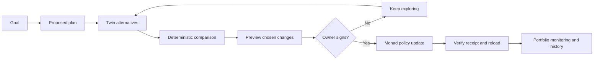

# Modalis

**A clear plan for every goal. Powered by Monad.**

Modalis turns a savings goal into a plan with limits the user approves. Modalis Twin lets
people explore other futures, compare the tradeoffs, and choose a new plan without moving
money while they experiment.

**[Try the product](https://modalis-six.vercel.app)** ·
**[Source](https://github.com/Timioni001/modalis)** ·
**[Contract references](docs/testnet-contracts.md)**


## The problem

People think in goals: a home deposit, school fees, a safety net. Investment tools usually
ask them to think in assets, allocations and trades. Changing a deadline makes the gap
worse: how much more should someone contribute, and what risk would they be accepting?

Modalis connects those decisions. A goal becomes a proposed allocation and explicit limits;
alternative futures make the tradeoffs visible before the user signs anything.

## What we built

- **Goal-based planning:** describe a goal, set a target and deadline, and review the plan
  in plain language. Contribution settings include the smallest amount per contribution.
- **Multiple goals and saved plans:** add and prioritize goals, save named alternative
  plans, and return to them later. Each wallet has **one active onchain policy**; saved
  alternatives are not separate funded portfolios.
- **Modalis Twin:** create, duplicate and compare futures by changing the target, timeline,
  monthly contribution, planned withdrawal and risk preference.
- **Owner-approved changes:** preview the chosen future's policy update, sign it, verify
  the Monad receipt, and reload the updated plan.
- **Savings and payments:** add test tokens, retrieve supported amounts, and send or
  request payments through the existing wallet flow.
- **Monitoring and history:** compare portfolio state against approved limits, inspect
  proposed adjustments, and follow confirmed actions through receipts and indexed events.

## A judge's walkthrough

The hosted experience uses **Monad Testnet (chain ID 10143)**. Use test assets only.

1. Open the product and choose **Try the demo**. Sign in through Dynamic. The public
   `/demo` preview can also be explored without signing in.
2. Create a goal, for example a $30,000 home deposit in five years. Review the proposed
   allocation and limits, then approve the plan in the wallet. Testnet MON is needed for gas.
3. Open **Modalis Twin** at `/app/scenarios`. Create an alternative with a three-year
   deadline. Adjust contributions and compare projected balances, shortfalls and downside
   outcomes beside the current plan.
4. Save the alternative with a name. Select it and review the exact proposed changes.
   Exploring, calculating and saving alternatives do not move funds.
5. Approve the policy update in the wallet. Follow the receipt and reload the plan to
   confirm its new version. This transaction changes the policy; it does not itself trade,
   deposit or withdraw assets.
6. Add test money if the faucet is configured, or use available test tokens. Review the
   portfolio and Activity. Inspect contract addresses and transactions in the explorer.
7. Add another goal or save another plan to show how ongoing decisions fit beside the
   active policy.

If prices are stale, exact supported token actions and read-only planning may remain
available, while valuation-dependent actions pause. Twin labels a saved starting amount
when a live valuation cannot be used. Service diagnostics are at `/status`.

## How the system works



The Next.js application reuses the domain, portfolio, execution and authentication packages.
`PortfolioMandate` stores the approved policy, `PortfolioVault` accounts for holdings, and
`RebalanceExecutor` validates supported adjustments. Offchain records store goals, drafts
and explanations; they do not replace contract state.

### Financial calculations

Twin uses deterministic integer USD arithmetic at 18-decimal precision. It calculates
fixed downside, expected and upside paths, applies monthly growth before contributions,
and compares required contributions and remaining shortfalls. Risk profiles and return
assumptions are explicit in [the simulation code](packages/domain/src/twin.ts).

The displayed goal-confidence measure weights those three paths 25% / 50% / 25%. It is an
educational scenario score, **not a calibrated market probability**. Taxes, fees, trading
costs and unentered cash flows are excluded. AI can interpret a question or explain an
outcome; it does not generate the financial figures. See [Twin documentation](docs/twin.md).

### Authorization and execution

- Server actions derive the acting wallet from the verified session.
- The owner approves policy changes and withdrawals. A manager's authority is bounded by
  the contract and can be revoked.
- Execution checks include authorization, mandate version, expiry, replay protection,
  allowed venues, allocation bounds, liquidity and slippage.
- A failed policy check reverts the transaction. A transaction hash alone is not treated
  as a successful action; the receipt and resulting state must be checked.

## Track fit and sponsor integrations

**Primary track: Consumer Products & Payments.** Modalis makes savings, planning and
wallet actions understandable through goals. Its portfolio rules and execution layer also
provide an Onchain Finance & Trading use case, subject to the event's track selection rules.

These are implementation descriptions, not a claim that every external service is currently
configured or live. Check `/status` and the linked integration documentation when reviewing.

| Technology | Role in Modalis | Scope and evidence |
| --- | --- | --- |
| **Monad** | Approved policies, holdings and transaction settlement | Contract source in [`contracts`](contracts); testnet references in [deployment records](docs/testnet-contracts.md). |
| **Dynamic** | Sign-in, embedded/external wallet signing and verified server identity | [`packages/auth`](packages/auth), [Dynamic integration guide](docs/dynamic.md). Server-wallet execution needs separate configuration. |
| **Envio HyperIndex** | Indexes mandate, vault, rebalance and risk events for history | [Handlers and schema](integrations/envio). Hosted use requires an active, synced indexer and `ENVIO_GRAPHQL_URL`; RPC fallback is not evidence of Envio usage. |
| **Alchemy** | Configurable Monad RPC transport for chain reads and transactions | [Configuration guide](docs/integrations.md). Actual Alchemy usage requires its endpoint; a public RPC fallback is not an Alchemy integration demonstration. |
| **Chainlink CRE** | Scheduled market-signal and portfolio-risk workflow reporting to `RiskSignalReceiver` | [Workflow and verification scope](integrations/chainlink-cre/README.md). A successful CLI simulation or deployed workflow must be demonstrated separately; source and unit tests do not establish DON execution. The receiver cannot move funds. |
| **Kuru** | Allowlisted orderbook adapter for supported rebalance routes | [Adapter design](integrations/kuru/README.md). Demo tokens have no Kuru market; the testnet demo venue must not be presented as a live Kuru fill. |

## Verification and reproducibility

Run from the repository root after following the [setup guide](README.md#quick-start):

```bash
# Domain behavior, including Twin validation and comparison
pnpm --filter @modalis/domain test

# App authorization tests and TypeScript checks
pnpm --filter @modalis/web test
pnpm --filter @modalis/web typecheck

# Contract policy and execution checks
pnpm contracts:test

# Full local-chain demonstration
bash scripts/demo-local.sh
```

Specific safety cases to inspect:

- [`packages/domain/test/twin.test.ts`](packages/domain/test/twin.test.ts) rejects an
  invalid withdrawal before changing scenario inputs and checks that comparison leaves
  the live future unchanged.
- [`contracts/test/Modalis.t.sol`](contracts/test/Modalis.t.sol) covers rejected proposals,
  liquidity breaches, stale policies, replay and unauthorized callers.
- [`contracts/test/KuruAdapter.t.sol`](contracts/test/KuruAdapter.t.sol) exercises adapter
  settlement against a mock router, not a live orderbook.
- [`contracts/test/RiskSignalReceiver.t.sol`](contracts/test/RiskSignalReceiver.t.sol)
  checks receiver behavior separately from CRE network execution.

These commands describe reproducible checks; this document does not assert a fresh test
run or live sponsor deployment. See [deployment instructions](docs/deployment.md) for
production configuration and [security notes](docs/security.md) for the trust boundaries.

## Current boundaries

The hosted product is a technical demonstration, not a production investment service.
Test tokens and demo prices do not represent real assets or market returns. Multiple
independently funded policies per wallet are outside the current contract model. Saved
goals and drafts depend on configured persistence; external indexing and automation depend
on their running services. The landing-page waitlist currently confirms locally and does
not collect or store email addresses.

The next milestone is validating the complete supported flow against live configured
services, then expanding portfolio isolation and market coverage without weakening the
owner's approval boundary.
