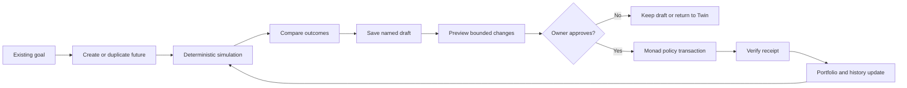
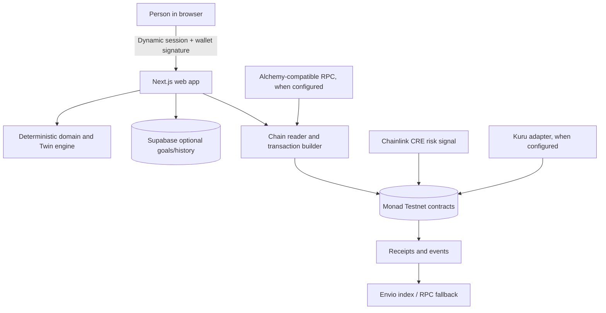

# MODALIS

**A clear plan for every goal.**

Modalis is a consumer savings and payments product powered by Monad.

Tell Modalis what you are saving for. It builds a plan, you approve the limits, and it manages
your money to them — and it cannot step outside them, because the limits are not enforced by
Modalis.

> Modalis recommends. Your rules decide. Nothing else can move your money.

---

## Try Modalis

Use this order when reviewing the product:

1. Open `/demo` and move the goal sliders. The preview is sample data and requires no wallet.
2. Choose **Try the demo**, sign in with Dynamic on Monad Testnet, and open the app overview.
3. Create or review a goal, then approve its limits. Additional goals can be added and ordered;
   saved plan drafts are separate from the one active wallet policy.
4. Open **Modalis Twin**. Duplicate the live future, change assumptions, and compare contribution
   requirements, projected balances, shortfalls and fixed downside paths.
5. Save a named draft. Select it to preview the exact policy change, approve it in the wallet,
   wait for the Monad receipt, and reload the plan to verify the new version.
6. Fund with demo mUSD, use Payments to send or request, and use Activity to inspect receipts.

The calculation engine is deterministic integer/decimal code with documented assumptions. AI may
interpret free text and explain a result, but it never supplies financial numbers.

### Desktop preview


## Product and system graphs

The core user journey is intentionally linear. Branches remain read-only until the person chooses
one and signs the proposed policy update.



The trust boundary keeps consumer language in the web and domain layers while the contracts remain
the final authority over money.



This is a capability graph, not a claim that every sponsor service is live in the hosted demo.
The runtime status page and sponsor matrix identify what is configured, what is fallback, and what
still needs a credential or live market.

## The idea

Most people can say what they need their money to do. Far fewer can say which assets to own, how
much risk they can afford, or when to rebalance. Almost nobody wants to learn.

Modalis turns the first into the second, and then makes the result **enforceable**. A plan is a
goal and a date plus four limits in plain language — how much you are comfortable losing, how much
money stays available, the most that can sit in one investment, and how far off target something
can drift before Modalis steps in. You approve it. From then on it is a boundary on Modalis's own
authority, not a setting.

What a person sees:

```
GOAL → PLAN → MONEY → PROGRESS → ADJUSTMENTS → ACTIVITY
```

What actually happens underneath, unchanged:

```
GOAL → PROFILE → MANDATE → ONCHAIN POLICY → PORTFOLIO
     → MONITORING → BREACH → PROPOSAL → VALIDATION
     → EXECUTION → SETTLEMENT → UPDATED STATE ↺
```

The second is the engineering. The first is the product. `packages/domain` is the boundary between
them, and the only place where one becomes the other — see
[`docs/domain.md`](docs/domain.md).

> **Deploying Modalis?** [docs/deployment.md](docs/deployment.md) covers the Vercel settings,
> environment variables and Monad testnet configuration.

## Quick start

```bash
bash scripts/setup.sh        # Node 22+, pnpm, Foundry, deps, ABIs  (Ubuntu / WSL2)
bash scripts/verify.sh       # everything verifiable offline
bash scripts/demo-local.sh   # the complete loop on a real local chain
# In a second terminal, leave the chain running:
bash scripts/dev-local.sh    # functional browser app, no hosted keys required
```

`scripts/demo-local.sh` runs eleven steps end to end and writes a report with real transaction
hashes to `docs/e2e-run.md`.

The database schema and its row-level security are checked separately, against a real Postgres:

```bash
pnpm db:local && pnpm db:check
```

To deploy to Monad testnet, fill in `.env` and:

```bash
pnpm contracts:deploy:testnet
```

## Demo and payments

Modalis is a consumer savings and payments product powered by Monad Testnet. “Try the demo” opens
`/demo`: an account-free interactive preview with clearly labelled sample data. Wallet sign-in loads
only when entering the actual testnet flow.

`/app/payments` supports sending demo dollars, generating and sharing payment-request links, and opening contract-backed savings circles. Requests specify the recipient, mUSD amount and Monad testnet network, then open a review screen. A link confers no authorization: only the sender's approved transaction transfers tokens. mUSD is valueless test money.

`/app/scenarios` is **Modalis Twin**. It keeps the current plan beside an editable alternative,
calculates deterministic downside/expected/upside paths, lets the person save a branch, and shows
the exact owner-signed plan update before anything reaches Monad. Exploring and saving a branch
never move funds. The flow and calculation assumptions are documented in
[`docs/twin.md`](docs/twin.md).

The phone header and dock collapse into labelled, keyboard-accessible sheets. The app reserves viewport space for its dock, so form fields and legal links remain above it. Optional destinations follow deployment capabilities. Motion honours reduced-motion preferences.

## Verification status

Stated precisely so the product never overclaims. **Verified by execution** means a command in this
repository runs it and it passes.

### Verified by execution

| | |
|---|---|
| **54 contract tests pass** | mandate enforcement, access control, replay, slippage, pause, emergency exit, Kuru adapter, CRE report decoding |
| **306 package and web tests pass** | 240 package tests (portfolio 9, execution 6, intelligence 32, chain 26, persistence 7, authentication 28, domain 132) plus 66 web tests |
| **Sign-in is verified against real signatures** | tokens signed with a real key pair and verified through the real JWKS path; a token signed by the wrong key, expired, unsigned or issued for another deployment is refused |
| **No route can act on an account the caller does not own** | a static audit over every route in the app: the acting account comes from a verified session, never from a body, path or query string |
| **No protocol vocabulary reaches a person** | every user-facing sentence in the domain layer is swept for it, and the guard is tested against a planted leak |
| **The full loop runs on a real EVM node** | 11/11 steps, 13 real transactions, idempotent across runs |
| **An invalid proposal reverts on-chain** | submitted for real with an explicit gas limit, `MAX_ALLOCATION_EXCEEDED`, portfolio asserted unchanged |
| **The manager key cannot withdraw** | asserted in both the contract tests and the end-to-end run |
| **1,296 interview combinations produce valid mandates** | every generated plan satisfies the contract's own rules |
| **The web app builds and serves the whole flow** | all API routes exercised against live chain state |
| **The CRE report encoding matches its contract** | a payload from the workflow is decoded by `RiskSignalReceiver` in a forge test |
| **The Envio config is schema-valid** | checked against Envio's own `evm.schema.json`, plus every event verified against the ABI |
| **The database schema applies and its row-level security holds** | 13 tables and 7 enums on a real Postgres 16, then 15 adversarial assertions: one person reading another's goals or mandates, forging a mandate or transaction row, taking over a wallet, or reading anything without signing in — all refused (`pnpm db:check`) |

### Built, but not yet run against the live service

Each needs a credential or network access the build environment did not have. None is claimed as
working in the UI — `/api/status` reports the real state and the landing page renders it.

- **Hosted Monad operation.** An existing testnet deployment and RPC were checked publicly during this repair. Its demo oracle quotes were expired; live balances and trading need the oracle owner to refresh them. This session has not deployed or verified a mainnet system.
- **Dynamic server wallet.** Needs `DYNAMIC_API_TOKEN` and `pnpm agent:create`
  ([docs/dynamic.md](docs/dynamic.md)). Without them the manager key signs adjustments instead.
- **Kuru.** The adapter is tested through the full execution path against a mock router built from
  the real ABI, but not against live markets.
- **Chainlink CRE.** Needs the CRE CLI and `cre login` to simulate or deploy.
- **Envio hosting.** CLI codegen, generated handler types and config validation pass. Hosted syncing and a live GraphQL endpoint still require service configuration.
- **Alchemy.** Needs an API key; falls back to the chain's public RPC.
- **The AI layer.** Needs `AI_API_KEY`. Without it the deterministic pipeline runs and the product
  works end to end — the LLM only reads free-text goals and writes prose.

### Deliberately not built

- **Perpl.** The brief marks it optional and warns against leveraged perps in a goal-based wealth
  product. Nothing in the UI implies it exists.

## Resilience and personal settings

Open **Your limits → Custom savings details** during onboarding, or **Your plan → Edit savings
preferences** after saving the approved goal. The minimum means the smallest complete contribution,
not a minimum balance or opening deposit. The setting accepts cents from $0 to $100,000, where zero
means no personal minimum. A contribution below the chosen amount is refused by the funding planner
before a wallet signature. A personal retrieval reminder can be set from 0 to 3,650 UTC days after
plan approval; it is a reminder, not a hidden vault lock. The owner can still withdraw, subject to
the existing contract rules. Optional context is capped at 500 characters and is never treated as a
payment instruction. See the [research and product distinction](docs/metropolis-research.md#savings-minimums-and-retrieval-timing-research).

The hosted demo remains useful when synthetic portfolio quotes expire. Approved plans, goal
definitions, exact token quantities, payments, transfers and manual Twin calculations continue to
work. Add money and Withdraw use owner-signed exact mUSD transfers and do not present token
quantities as current dollar values. `/api/status` reports quote, signer, database, indexer and
optional integration health independently, so one unavailable service does not hide the rest of the
product. Authenticated price recovery only republishes existing positive testnet quotes when a
configured key matches the deployed oracle owner; it never replaces the oracle or signs a public
status check. See [`docs/deployment.md`](docs/deployment.md) for Vercel environment variables.

## What is real and what is simulated

One synthetic input, clearly marked everywhere it appears:

| | |
|---|---|
| **Simulated** | the demo oracle price move that creates the breach, and the demo ERC-20s |
| **Real** | the mandate, the balances, the breach computed from them, the proposal, the contract's decision, the execution, the settlement, and every transaction hash |

No transaction hash in this repository is fabricated. Where a step sent no transaction, it has no
hash. The scenario engine refuses to run on mainnet, and where Kuru is unconfigured the UI labels
the demo adapter "not a venue".

## How Modalis uses Dynamic

- **Sign-in and the person's wallet.** An email sign-in creates an embedded Monad wallet the
  person owns. It signs every owner action, and adding money approves and deposits in one
  signature where the wallet supports batched calls.
- **Who is asking.** The server trusts only the wallet address inside a verified Dynamic JWT
  (`packages/auth`), never an address sent in a request.
- **"Do it for me" runs from a Dynamic server wallet.** The person delegates by signing
  `setManager(agent)` from their embedded wallet. The agent can only call
  `RebalanceExecutor.execute` inside the plan's limits; it can never withdraw or change a limit,
  and **Revoke adjustments** in Settings takes the permission back. The agent's address and its
  transactions are labelled "Dynamic server wallet" on `/security` and on each plan's proof page.

Details, setup and the code paths: [docs/dynamic.md](docs/dynamic.md). A two-minute demo script: [docs/dynamic-video-script.md](docs/dynamic-video-script.md).

## How Modalis uses Envio

A hosted Envio indexer reads Modalis portfolio and plan events from Monad: plans and their versions, deposits,
withdrawals, settled adjustments and risk signals. When `ENVIO_GRAPHQL_URL` is set, the Activity
page and `/stats` read from it and say "Indexed by Envio"; if it doesn't answer, both fall back to
reading the chain directly.

- Hosted GraphQL endpoint: (added once the hosted indexer is live)
- Config: [`integrations/envio/config.yaml`](integrations/envio/config.yaml) (hosted copy with
  real addresses: [`config.hosted.yaml`](integrations/envio/config.hosted.yaml))
- Schema: [`integrations/envio/schema.graphql`](integrations/envio/schema.graphql)
- Handlers: [`integrations/envio/src/handlers/`](integrations/envio/src/handlers/)
- Readers in the app: `packages/domain/src/services/activity.ts`, `apps/web/lib/envio-stats.ts`

## How Modalis uses Chainlink CRE

A CRE workflow watches each plan on a schedule. Every node fetches a public market feed through
the HTTP capability and the DON agrees on the median "market stress"; the workflow combines that
with the plan's state read from Monad, using the same risk engine as the app, and writes a
DON-signed risk signal to `RiskSignalReceiver`. It can flag a plan for review; it can never move
money. Code and the consensus rules: [integrations/chainlink-cre](integrations/chainlink-cre/README.md).

## Architecture

```
apps/web            the questions · plan approval · money · add money · progress · activity · what-if
packages/domain     THE PRODUCT: goal, plan, money, progress, adjustment, activity, receipt
packages/auth       who is asking — a verified session, never an address from a request
packages/db         goals, answers, explanations and the adjustments the rules refused
packages/ai         risk profiler → allocation planner → mandate builder → explanations
packages/portfolio  allocation · drift · concentration · liquidity · rebalance planner
packages/chain      the only place the app talks to Monad (ABIs generated from the artifacts)
packages/execution  venue selection: Kuru, or the demo adapter
services/           risk-monitor (the control loop + scenario engine), demo (the E2E runner)
contracts/          AssetRegistry · PortfolioMandate · PortfolioVault · RebalanceExecutor
                    KuruAdapter · RiskSignalReceiver
integrations/       kuru · chainlink-cre · envio
supabase/           application state (goals, interviews, explanations) with RLS
```

`packages/domain` speaks only the product's language: a plan, how your money is spread, an
adjustment, a receipt. `packages/domain/src/translate.ts` is the single file that reads protocol
shapes, so no user interface ever has to know what a mandate or a basis point is. The Solidity
keeps its own precise names — `PortfolioMandate`, `PortfolioVault`, `RebalanceExecutor` — because
down there they are correct.

Full detail in [`docs/architecture.md`](docs/architecture.md). The repair architecture,
integration notes and verification record are in [`docs/rebuild-architecture.md`](docs/rebuild-architecture.md),
[`docs/metropolis-research.md`](docs/metropolis-research.md) and [`docs/rebuild-verification.md`](docs/rebuild-verification.md).

## Security model

Every proposal is checked on-chain for authorisation, mandate active, mandate version (anti-stale),
deadline, nonce (anti-replay), a slippage floor derived from the oracle, an approved venue, and
**post-trade mandate compliance**. Any failure reverts the whole transaction.

| Actor | Can | Cannot |
|---|---|---|
| Owner | set the mandate, deposit, withdraw, revoke, pause | be bypassed |
| Manager (backend key) | call `RebalanceExecutor.execute` | withdraw, change rules, pick an unapproved venue |
| AI layer | propose and explain | hold a key or sign anything |
| Chainlink CRE | publish a risk signal | move funds |

Above the contracts, the server answers a second question — *who is asking?* Identity comes from a
verified sign-in token and nothing else. No route reads an account from its request body, path or
query string, and `apps/web/test/api-ownership.test.ts` audits every route to keep it that way.
Authentication does not replace the contract's enforcement; it only stops one person spending
another person's gas. The contract remains the final authority.

Adding money is split the same way on purpose: the server works out **what** should happen, and
the person's own account **does** it. No Modalis key can put money in, which is the same reason no
Modalis key can take it out.

Full detail, including known limitations and a mainnet checklist, in
[`docs/security.md`](docs/security.md).

## Documentation

| | |
|---|---|
| [`docs/domain.md`](docs/domain.md) | The product's vocabulary, the domain model, the API, and where technical language stops |
| [`docs/architecture.md`](docs/architecture.md) | How the layers fit together and why the allocation is deterministic |
| [`docs/security.md`](docs/security.md) | Authority model, the validation pipeline, limitations, mainnet checklist |
| [`docs/bounty-matrix.md`](docs/bounty-matrix.md) | Each sponsor integration and exactly what is proven |
| [`docs/demo.md`](docs/demo.md) | The three-minute script and answers to the obvious questions |
| [`docs/twin.md`](docs/twin.md) | Modalis Twin flow, deterministic assumptions and approval boundaries |
| [`integrations/kuru/README.md`](integrations/kuru/README.md) | ABI provenance and execution safety |
| [`integrations/chainlink-cre/README.md`](integrations/chainlink-cre/README.md) | The risk workflow and its narrow scope |
| [`integrations/envio/README.md`](integrations/envio/README.md) | Indexed entities and design notes |

## Commands

```bash
pnpm verify              # everything verifiable offline
pnpm demo                # the full loop on a local chain
pnpm dev                 # the web app

pnpm contracts:test      # forge tests
pnpm contracts:build
pnpm contracts:sync-abis # regenerate ABIs for the app and the indexer
pnpm test                # TypeScript tests: packages + the API ownership audit
pnpm typecheck

pnpm db:local            # a throwaway Postgres with the schema applied
pnpm db:check            # the row-level security checks (15 adversarial assertions)
pnpm db:types            # regenerate the TypeScript types from the live schema
pnpm db:down

pnpm risk-monitor:once   # evaluate watched portfolios once
pnpm envio:validate      # Envio config against Envio's own schema
```

## Promoting a deployment

The implementation was built on the local `work` branch and published to the Vercel-connected
preview branch `claude/awesome-gates-h1pxk0`. This repository currently has no remote `main`, so
the shortest safe promotion is:

```bash
git fetch origin
git switch --create main origin/claude/awesome-gates-h1pxk0
git push --set-upstream origin main
git push origin --delete claude/awesome-gates-h1pxk0
git branch -d work                 # optional: remove the local task branch after switching away
```

If a `main` branch is created before you run this, merge the preview branch instead:

```bash
git fetch origin
git switch main
git pull --ff-only origin main
git merge --ff-only origin/claude/awesome-gates-h1pxk0
git push origin main
git push origin --delete claude/awesome-gates-h1pxk0
git branch -d work
```

If either merge is not fast-forwardable, stop and resolve the divergence deliberately; do not force
push. After the push, set **Vercel → Project → Settings → Git → Production Branch** to `main` and
redeploy. The required Vercel root directory remains `apps/web`; the complete environment and
deployment guide is [`docs/deployment.md`](docs/deployment.md).

## Requirements

Node 22+ (the TypeScript runs directly via Node's type stripping), pnpm, Foundry, and Python 3 for
the Envio config check. `scripts/setup.sh` installs what is missing on Ubuntu / WSL2.

## Contracts on Monad testnet

Every deployed address, with its verified source on the Monad explorer, is listed in
[docs/testnet-contracts.md](docs/testnet-contracts.md). `bash scripts/verify-contracts.sh`
verifies them and regenerates that list.

## How this was built

Written with AI assistance (Anthropic's Claude, through Claude Code, and OpenAI Codex for this
functional repair), disclosed for transparency. Every design decision, every security boundary and
every line was reviewed before it landed. The guarantees the product claims are not taken on trust: they are
enforced by the Solidity contracts and proved by the test suites listed under
[Verification status](#verification-status), which anyone can run.

## Licence

MIT. See [LICENSE](LICENSE).

## Disclaimer

Prototype and technical demonstration only. Modalis is not an investment adviser, broker, fund or
pooled investment vehicle. Nothing here is financial advice, no return is promised or implied, and
no figure shown is a projection of future performance. Demo tokens exist only on test networks and
are not real investment assets. There has been no security audit — do not put meaningful funds
behind this.
